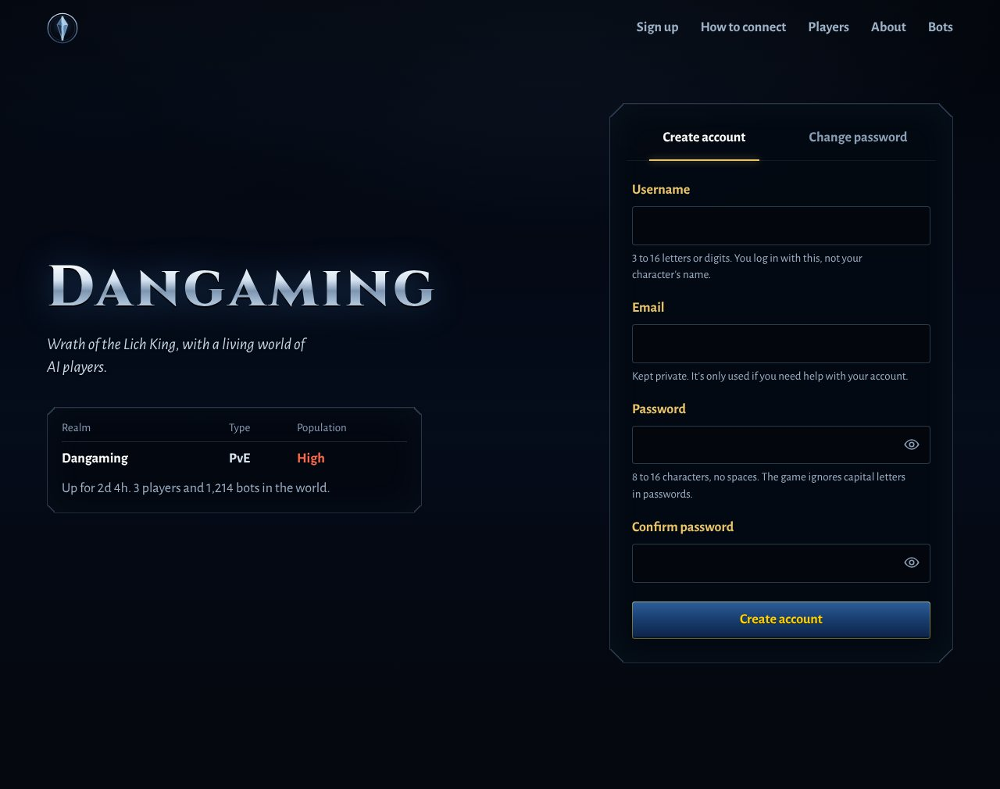
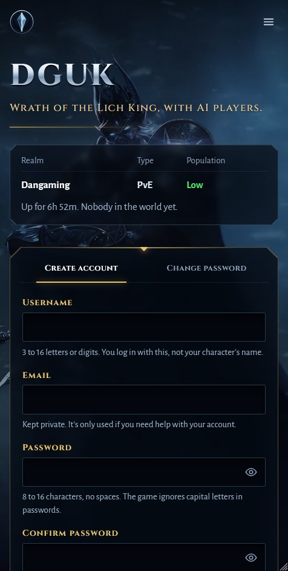

# azerothcore-websignup

A sign-up site for an [AzerothCore](https://www.azerothcore.org/) Wrath of the
Lich King (3.3.5a) server, made to sit beside a server that runs in Docker.
One small container, no PHP, nothing to install on the host.



Players can:

- **create an account**, ready to log in with straight away
- **change their password**
- see **how to connect**: the client download, the `set realmlist` line with
  a copy button, and fixes for the usual problems
- see whether the **realm is up**, its uptime, and how many players and bots
  are in the world, the way the game's realm list shows it
- see **who's online** and the **top players**, names in their class colours
- read **about the server**, a **guide to playing with bots**, and your
  **rules**, in text you can change without touching the code

It works on phones as well as desktops. The look of the top of the page is
yours: a background picture or video and particles floating across it, from
files you drop into a folder (see [theme/README.md](theme/README.md)).



## Quick start

On the machine that runs AzerothCore in Docker:

```bash
git clone https://github.com/kamakazedan/azerothcore-websignup.git
cd azerothcore-websignup
./setup.sh
```

`setup.sh` makes a `.env` with a fresh database password and secret key,
creates a MySQL user for the site with only the rights it needs, then builds
and starts the container. It asks for the MySQL root password; press Enter
to use the one the database container was started with.

Then check the settings in `.env` (what the page says: `SITE_NAME`,
`REALMLIST`, `CLIENT_DOWNLOAD_URL` and so on) and run
`docker compose up -d` to pick up any changes.

The site listens on port 8090 of the host. Point your reverse proxy at it
(see below), or try it at `http://<host>:8090`.

## Doing it by hand

1. `cp .env.example .env`, then set `DB_PASSWORD` (letters and digits are
   safest) and `SECRET_KEY` (`openssl rand -hex 32`).
2. Create the database user with that password. This fills it in on the way
   through, so it isn't saved in a file git tracks:
   ```bash
   pw=$(grep '^DB_PASSWORD=' .env | cut -d= -f2)
   sed "s/{{PASSWORD}}/'$pw'/g" sql/create-user.sql | docker exec -i ac-database mysql -uroot -p
   ```
3. Check `AC_NETWORK` in `.env` matches AzerothCore's Docker network
   (`docker network ls | grep ac-network`).
4. `docker compose up -d --build`

## Running it in Portainer

Portainer doesn't reliably build images while it deploys a stack, so you
build the image once, then a stack runs it.

1. On the server, make a folder for your own files:
   `mkdir -p ~/websignup/theme ~/websignup/content`
2. If you haven't yet, create the database user (step 2 of "Doing it by
   hand", or run `setup.sh` once).
3. In Portainer, go to **Images → Build a new image**. Name it
   `azerothcore-websignup:latest`, choose the **URL** build method, enter
   `https://github.com/kamakazedan/azerothcore-websignup.git`, and leave
   the Dockerfile path as `Dockerfile`. Build it.
4. Go to **Stacks → Add stack**, call it `websignup`, choose **Web editor**
   and paste in [`portainer-stack.yml`](portainer-stack.yml).
5. Under **Environment variables**, add at least:
   - `DB_PASSWORD`: the `websignup` database user's password
   - `SECRET_KEY`: 64 hex characters (`openssl rand -hex 32`)
   - `WEBSIGNUP_FILES`: the folder from step 1, such as `/home/you/websignup`

   then whatever the page should say (`SITE_NAME`, `REALMLIST`,
   `CLIENT_DOWNLOAD_URL`, `PUBLIC_URL`, ...). The quick way is **Advanced
   mode**: paste in lines written like `.env.example`, comments and all.
6. Click **Deploy the stack**.

To update, build the image again (step 3), then open the stack and click
**Update the stack**. Leave **Re-pull image** off: the image is only on
your server, so there's nowhere to pull it from.

### Moving a `docker compose` install into Portainer

1. Print the settings it uses, to paste in at step 5 above:
   `cat ~/azerothcore-websignup/.env`
2. Remove the old container: in Portainer, **Containers**, tick
   `ac-websignup`, **Remove**. Or `cd ~/azerothcore-websignup && docker
   compose down`. The new one takes the same name and port, so the old one
   has to go first, and your reverse proxy needs no change.
3. Follow the steps above. The database user already exists, so skip
   step 2. Copy anything of your own from the old `theme` and `content`
   folders into the new ones.

## Your own look

The background picture or video, the floating particles and how they move,
the logo and the tab icon all come from files in the theme folder (`theme`
here, or `theme` inside `WEBSIGNUP_FILES` with Portainer). The site picks
up changes within a few seconds. [theme/README.md](theme/README.md) lists
the files and settings; `theme/theme.conf.example` is a settings file to
start from.

## Behind Nginx Proxy Manager

Add a proxy host for your domain:

- Forward hostname or IP: the Docker host's address. Forward port: `8090`.
  Scheme: `http`.
- Turn on **Block common exploits**. On the SSL tab, request a certificate
  and turn on **Force SSL**.

Once it's only reached over https, set `HSTS=1` in `.env`.

The site takes the visitor's address from `X-Forwarded-For`, but only from
addresses in `TRUSTED_PROXIES`, and the per-address limits count by it
(IPv6 by /64). The default trusts every private network, which works
wherever Nginx Proxy Manager runs on your LAN or in Docker. The catch is
that anything on those networks reaching port 8090 directly can choose the
address it's counted as.

To close that, set `TRUSTED_PROXIES` to the address the proxy's requests
arrive from (for a proxy in Docker, its network's range from
`docker network inspect`), or put the site on the proxy's Docker network
and remove the `ports:` lines from `docker-compose.yml`. Get it right: if
the proxy's requests come from an address the site doesn't trust, every
visitor counts as that one address, and three sign-ups in a day close the
form for everyone.

## Settings

All in `.env`. The defaults suit AzerothCore's own Docker setup.

| Setting | Default | What it does |
|---|---|---|
| `SITE_NAME` | `AzerothCore` | The big name at the top of the page, and the page title |
| `TAGLINE` | `Northrend awaits. Your legend begins here.` | The line under it, kept to one line (it shrinks to fit, so shorter reads bigger) |
| `REALMLIST` | | The address in `set realmlist ...` |
| `CLIENT_DOWNLOAD_URL` | | A client to download. Empty hides the button |
| `CLIENT_HAS_REALMLIST` | `1` | That client already points at the realm, so its players can skip setting the realmlist |
| `GAME_VERSION` | `3.3.5a (12340)` | |
| `PUBLIC_URL` | | The site's address, e.g. `https://wow.example.com` |
| `REGISTRATION` | `1` | `0` closes sign-ups |
| `CHANGE_PASSWORD` | `1` | `0` turns off password changes |
| `SHOW_ONLINE_PLAYERS` | `1` | |
| `SHOW_TOP_PLAYERS` | `1` | |
| `ONLINE_LIST_SIZE` | `50` | |
| `TOP_LIST_SIZE` | `10` | |
| `HIDE_ACCOUNTS` | | Accounts kept out of the lists, comma separated |
| `BOT_ACCOUNT_PREFIX` | `RNDBOT` | Playerbots' accounts: counted as bots, never listed, and reserved |
| `MIN_PASSWORD_LENGTH` | `8` | Between 4 and 16; the game allows no more than 16 |
| `ACCOUNTS_PER_IP_PER_DAY` | `3` | |
| `ALLOW_SHARED_EMAIL` | `0` | `1` lets accounts share an email address |
| `EXPANSION` | `2` | 2 is Wrath |
| `DB_HOST`, `DB_PORT` | `ac-database`, `3306` | |
| `DB_USER`, `DB_PASSWORD` | `websignup` | Or `DB_PASSWORD_FILE` for a Docker secret |
| `DB_TLS` | `preferred` | `true`, `skip-verify` or `false` |
| `AUTH_DB`, `CHARACTERS_DB` | `acore_auth`, `acore_characters` | |
| `REALM_ID` | `1` | |
| `SECRET_KEY` | random at each start | Signs the anti-bot challenges |
| `POW_DIFFICULTY` | `18` | Each step doubles the browser's work |
| `TRUSTED_PROXIES` | private networks | Who may set `X-Forwarded-For` |
| `HSTS` | `0` | |
| `WORLD_ADDR`, `AUTH_ADDR` | `ac-worldserver:8085`, `ac-authserver:3724` | Checked to tell whether the realm is up |
| `WEB_PORT`, `WEB_BIND` | `8090`, `0.0.0.0` | Where the container is published |
| `AC_NETWORK` | `azerothcore-playerbots_ac-network` | AzerothCore's Docker network |

## Changing the text

The connection tips, "About", the bot guide and the rules are HTML files.
Put your own version in the `content` folder and the page uses it within a
few seconds, no restart needed. `content/README.md` explains more. The
built-in versions, in `internal/site/content/`, are where to start.

There are no rules by default: write `content/rules.html` to add them.

## Updating

```bash
git pull
docker compose up -d --build
```

## How it keeps things safe

- **The database user can do very little.** It can look up and add
  accounts and set a new password, read the realm's name and uptime, and
  read the columns of `characters` the lists need. Nothing else, and it
  can't delete anything. Don't give the site root.
- **Passwords never touch the database.** The site makes the same salt and
  SRP6 verifier the server does (checked against AzerothCore's own code),
  and checks the old password the same way for a change.
- **No captcha service.** Each form carries a small proof of work that the
  browser solves while the player types, plus a hidden field bots fill in,
  plus limits on attempts and accounts per address, per account and for the
  whole site. The limits are taken before the work is done, so requests
  sent all at once can't slip past them, and memory for them is capped.
- **Playerbots' own accounts are off limits.** Nobody can sign up with a
  name that starts with `BOT_ACCOUNT_PREFIX`, or change the password of
  one. See below for why that matters.
- **No cookies and nothing stored in the browser.** Forms are only accepted
  from the site's own page.
- **A strict Content Security Policy:** no inline script or style, nothing
  loaded from anywhere else, no framing.
- **A small container:** a static Go binary on a distroless image, running
  as a non-root user on a read-only filesystem with no capabilities.

### Playerbots' account passwords

With `Playerbots.RandomBotRandomPassword = 0` in `playerbots.conf`, every
random bot account's password is its name: anyone with the game client can
log in as `RNDBOT1` with the password `RNDBOT1` and take over that bot's
characters. That's nothing to do with this site, which refuses those
accounts, but it's worth closing on the server:

1. Set `Playerbots.RandomBotRandomPassword = 1`, so bot accounts made from
   now on get random passwords.
2. Give the existing ones a login nothing can match. Bots never log in with
   a password, so they carry on as before. With a backup taken:
   ```sql
   UPDATE acore_auth.account
      SET salt = RANDOM_BYTES(32), verifier = RANDOM_BYTES(32)
    WHERE username LIKE 'RNDBOT%';
   ```

### Things it doesn't try to hide

- The sign-up form says when an email address already has an account, so
  someone could check whether an address is registered. Hiding it would
  need emailed confirmations.
- Five wrong passwords for an account in 15 minutes stops password changes
  for it on the site for 15 minutes, for its owner too. Logging in to the
  game isn't affected.

## Trying it without a server

Demo mode shows the site with made-up players and doesn't touch any
database:

```bash
docker build -t websignup .
docker run --rm -p 8090:8080 -e DEMO_MODE=1 -e SITE_NAME=Frosthold websignup
```

## Working on it

Go 1.24 or newer. `go test ./...` runs the tests, and
`DEMO_MODE=1 go run .` serves the site on port 8080. Everything the page
uses is built into the binary, so restart after changing a template or a
stylesheet.

- `main.go`: settings
- `internal/site`: the page, its templates, styles, script, the forms,
  and the theme folder (`theme.go`)
- `internal/game`: the database, validation, demo data
- `internal/srp6`: AzerothCore's password verifiers
- `internal/pow`: the proof-of-work challenges
- `internal/ratelimit`: the limits

## Credits

The crystal emblem was drawn for this project. Nothing here comes from
Blizzard. World of Warcraft and Wrath of the Lich King are trademarks of
Blizzard Entertainment, Inc., and this project isn't made or endorsed by
them.

Fonts are under the SIL Open Font License: Cinzel by Natanael Gama, and
Alegreya Sans by Juan Pablo del Peral and Huerta Tipográfica.
See `internal/site/static/fonts/`.
